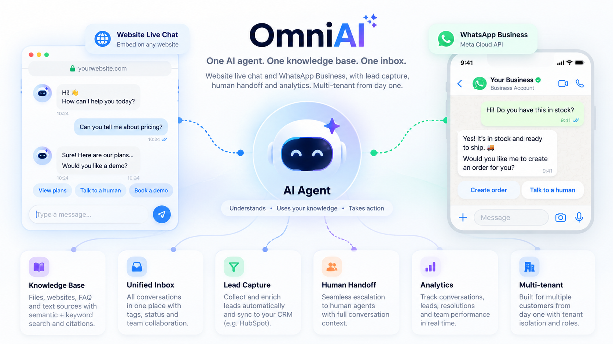

# OmniAI



An omnichannel AI customer-service platform: one AI agent, one knowledge base and one
inbox for **website live chat** and **WhatsApp Business**, with lead capture, human
handoff and analytics. Multi-tenant from day one.

> **Status:** Phases 1–9 of 10 are complete (10 hardening is next):
> - **Phase 1:** architecture, database, auth, roles, tenant isolation, admin dashboard,
>   Docker and demo data.
> - **Phase 2:** the **embeddable website chat widget**.
> - **Phase 3:** the **AI agent**: tools, intent detection, memory, guardrails and
>   escalation, with full settings under *AI Agent*.
> - **Phase 4:** the **knowledge base**: files, websites, FAQ and text sources, and
>   hybrid semantic + keyword retrieval with citations.
> - **Phase 6:** the **unified inbox**: website and WhatsApp conversations in one live
>   list, human takeover, replies on the original channel, assignment, notes, summaries
>   and AI-suggested replies.
> - **Phase 7:** **customers and leads**: profiles with history, tags and custom fields,
>   safe merging of duplicates, GDPR export and deletion, and a lead pipeline.
> - **Phase 8:** **analytics and AI insights**: KPIs with custom date ranges, top
>   questions, knowledge-base usage, AI cost, and the questions the bot couldn't answer.
> - **Phase 9:** **automations**, signed outbound **webhooks**, a **HubSpot**
>   connector and the integration interface, plus in-app notifications.
> - **Phase 5:** **WhatsApp Business** (Meta Cloud API): the same AI pipeline, media and
>   voice notes, delivery statuses, templates and automatic retries, managed under
>   *Channels*.
>
> See [docs/ARCHITECTURE.md](docs/ARCHITECTURE.md) for the design and the phase plan.
> Sidebar modules marked **Soon** are not built yet.

| Area | Technology |
|---|---|
| App | Next.js 14 (App Router), React 18, TypeScript (strict) |
| UI | Tailwind CSS, shadcn/ui, Recharts |
| Data | PostgreSQL 16 + pgvector, Prisma 6 |
| Auth | Auth.js (NextAuth v4), credentials + JWT sessions, bcrypt |
| Infra | Redis (rate limits, realtime pub/sub), S3-compatible storage (SeaweedFS locally) |
| Tests | Vitest (unit + integration against a real Postgres) |

---

## Quick start

Prerequisites: **Node.js 20.9+**, **Docker Desktop**.

```bash
npm install
npm run setup                 # creates .env and generates AUTH_SECRET / ENCRYPTION_KEY
docker compose up -d          # postgres (pgvector) :5433, redis :6379, s3 :9000
npx prisma migrate dev        # applies migrations
npm run db:seed               # NovaTech GmbH demo workspace
npm run dev                   # http://localhost:3000
```

Sign in with a demo account (password `NovaTech-Demo-2026`):

| Email | Role | Sees |
|---|---|---|
| `owner@novatech.demo` | OWNER | everything, including organization settings and the audit log |
| `admin@novatech.demo` | ADMIN | dashboard, chatbot, knowledge, customers, team (agents) |
| `agent@novatech.demo` | AGENT | inbox and customer conversations |

Or create a new workspace at `/register`.

> Postgres is mapped to host port **5433** so it doesn't clash with a local install.
> Override any host port with `POSTGRES_HOST_PORT`, `REDIS_HOST_PORT` or `S3_HOST_PORT`.

## Scripts

| Command | What it does |
|---|---|
| `npm run dev` / `build` / `start` | Next.js dev server / production build / production server |
| `npm run typecheck` · `npm run lint` | TypeScript and ESLint |
| `npm test` | all tests (unit + integration) |
| `npm run test:unit` | fast tests, no database |
| `npm run test:integration` | tests against the `omniai_test` database (needs `docker compose up -d`) |
| `npm run db:migrate` | create/apply a migration in development |
| `npm run db:deploy` | apply migrations (CI/production) |
| `npm run db:seed` | (re)create the NovaTech demo workspace (other organizations are untouched) |
| `npm run db:reset` | drop the dev database, re-migrate and re-seed |
| `npm run db:studio` | Prisma Studio |

## Configuration

All configuration comes from environment variables. See [.env.example](.env.example) for
the full list. Nothing secret is ever prefixed `NEXT_PUBLIC_`, so no secret reaches the browser.

| Variable | Required | Notes |
|---|---|---|
| `DATABASE_URL` | yes | PostgreSQL with the `vector` extension available |
| `AUTH_SECRET` | yes | ≥ 32 chars: `openssl rand -base64 32` |
| `NEXTAUTH_URL` / `APP_URL` | prod | public base URL |
| `ENCRYPTION_KEY` | yes* | 32 bytes base64; encrypts secrets stored in the DB (*needed once integrations are configured) |
| `ALLOW_REGISTRATION` | no | `false` = invite-only |
| `REDIS_URL` | recommended | without it rate limits fall back to per-process memory |
| `OPENAI_API_KEY` | for AI replies | chat + embeddings |
| `OPENAI_BASE_URL` | no | OpenAI-compatible endpoint (Azure, gateway, local) |
| `WHATSAPP_*` | for WhatsApp | Meta Cloud API credentials (see below) |
| `OPENAI_TRANSCRIPTION_MODEL` | no | voice-message transcription (default `whisper-1`) |
| `DISABLE_JOBS` | no | `true` = do not run background retries in this process |
| `S3_*` | for uploads | widget attachments (knowledge documents from phase 4) |

### OpenAI (phase 3+)
Set `OPENAI_API_KEY`. The models default to `gpt-4o-mini` (chat) and
`text-embedding-3-small` (embeddings, 1536 dimensions, which matches the `vector(1536)` column).

### WhatsApp Cloud API
1. Create a Meta app with the **WhatsApp** product and a business phone number.
2. In the server environment set `WHATSAPP_APP_SECRET` (from the app settings),
   `WHATSAPP_VERIFY_TOKEN` (any random string; `npm run setup` generates one) and
   `WHATSAPP_ACCESS_TOKEN` (a system-user token with `whatsapp_business_messaging` and
   `whatsapp_business_management`).
3. In the dashboard open **Channels**. As an owner, enter the **phone number ID** and the
   **WhatsApp Business account ID**. A workspace can optionally use its own access token,
   which is stored encrypted. Then click **Test connection**.
4. In Meta → WhatsApp → Configuration, set the callback URL shown on the Channels page
   (`https://<your-domain>/api/webhooks/whatsapp`) with the same verify token, and
   subscribe to `messages`. Meta requires a public HTTPS URL; for local testing use a
   tunnel such as `cloudflared` or `ngrok`.
5. Click **Sync from Meta** to load your message templates.

What happens then:
- WhatsApp messages run through the same AI agent, tools and inbox as website chat.
- Customers are matched by phone number, including people who already left that number
  in the website chat.
- Images, documents, audio, video, locations, contacts and button replies are
  understood; voice notes are transcribed (`OPENAI_TRANSCRIPTION_MODEL`).
- Replies use WhatsApp formatting and buttons.
- Every webhook is processed exactly once and failures retry automatically; the
  Channels page shows the recent webhook activity.
- WhatsApp only allows free-form messages within 24 hours of the customer's last
  message. After that, the team uses an approved template.
- Background retries run inside the app server (`instrumentation.ts`). Set
  `DISABLE_JOBS=true` if you run them elsewhere.

### Website widget
1. In the dashboard open **AI Agent → Website widget**, adjust name, welcome message,
   brand color, position and quick replies (the live preview updates as you type).
2. Add your site under **Allowed websites** (e.g. `https://www.example.com` or
   `https://*.example.com`). An empty list allows any site.
3. Paste the snippet shown there before `</body>`:
   ```html
   <script src="https://<your-domain>/chat-widget.js" data-bot-id="bot_xxxxxxxx" async></script>
   ```
4. Optional JavaScript API on your page: `window.OmniAI.open()`, `.close()`, `.toggle()`.

**Open test page** (AI Agent) embeds the real widget inside the dashboard; the **hosted chat
page** `/widget/<bot key>` works as a full-page chat link.

Without `OPENAI_API_KEY` the widget still works end to end: visitors get a polite,
localized "can't answer right now" reply with a *Talk to a human* action. To try streaming
without an OpenAI account, point `OPENAI_BASE_URL` at any OpenAI-compatible server.

### Knowledge base
Open **Knowledge Base** → **Add source**:

| Source | Notes |
|---|---|
| Files | PDF, Word (.docx), .txt or .md, up to 20 MB each. Page numbers and headings are kept for citations |
| Website | The main content of a page. Optionally add the same-site pages it links to (up to 25); `robots.txt` is respected |
| FAQ | Question/answer pairs; each pair is one passage |
| Text | Notes or policies, with Markdown headings for sections |

What happens to a source:
- It is processed in the background: extracted, cleaned, split into passages and
  embedded (`OPENAI_EMBEDDING_MODEL`, 1536 dimensions).
- Retrieval combines semantic search (pgvector, works across languages) with keyword
  search.
- **Test a question** shows exactly which passages the assistant would get.

Without `OPENAI_API_KEY`, keyword search is used. Embeddings are added automatically once
a key is configured.

### AI agent
Configure the agent in **AI Agent**:

| Tab | What you set |
|---|---|
| **Behavior** | Identity, tone, answer length, creativity, model, fallback answer, escalation (suggest / automatic / never) and which situations escalate |
| **Prompts** | Layered instructions (global policy, identity, personality, per-channel, business rules), with a preview of the full composed prompt |
| **Tools** | What the AI may do (leads, tickets, appointment requests, profile updates, handoff, …), the order-status connection, and a log of every tool call |
| **Products** | The price catalog. The AI quotes prices only from here or from the knowledge base |
| **Business hours** | When your team is online (drives handoff and the widget status) |

How replies are built:
- Every reply uses the customer's profile and memory, a summary of long conversations,
  and knowledge snippets matched to the question. The cited documents appear as
  *Sources* in the widget.
- Actions only happen through validated tools, and the AI may confirm an action only
  after the tool succeeded.
- Replies are checked for leaked secrets, prompt text and other people's contact details.

To try the agent without an OpenAI account, point `OPENAI_BASE_URL` at any
OpenAI-compatible server that supports tool calling.

Order status: connect your shop under **Tools → Order lookup connection** (owners only).
OmniAI calls `GET <your URL with {orderNumber}>?email=<customer email>` with an optional
Bearer key and expects JSON with at least `status` (404 = not found or wrong email).

### Inbox
**Inbox** shows website and WhatsApp conversations in one live list (filters: open /
closed, waiting, mine, unread, website, WhatsApp, AI, human, unassigned, and search).

- **Take over** stops the AI; the customer sees who joined. Simply replying takes over too.
  **Return to AI** hands the conversation back.
- Replies go out on the customer's channel, with attachments. On WhatsApp, after the
  24-hour window only approved templates can be sent (a dialog lists them).
- **AI suggestions:** *Generate reply*, *Shorten*, *Friendlier*, *Professional* and
  *Translate* fill the reply box. Nothing is sent until you press Send.
- The side panel shows the customer, the AI summary, leads, tickets, appointments,
  internal notes and earlier conversations.
- Agents can assign conversations to themselves; admins can assign anyone. Assignees and,
  for handoff requests, the team get a notification.

### Customers and leads
- **Customers:** search and filter everyone who has chatted; each profile shows contact
  details, tags, custom fields, channels, conversations, leads, tickets, appointments,
  notes and what the AI has learned. Admins can edit, **export** (JSON) or **delete** a
  customer with all their data.
- **Duplicates:** when a visitor types an email or phone that another profile already has,
  the profile shows *Possible duplicate*; merge it after checking. (Typed contact details
  are never merged automatically, so nobody can see another customer's history by typing
  their email. WhatsApp numbers are verified and linked automatically.)
- **Leads:** a pipeline from New to Won/Lost. Drag cards between stages, open a lead to
  edit it, set an owner and a value, add leads from calls or events, and export CSV.

### Analytics
**Analytics** shows conversations, customers, messages, AI resolution and escalation
rates, leads and conversion, response times, top questions and topics, knowledge-base
usage and estimated AI cost, for today, 7/30/90 days or a custom range, compared with the
previous period. Export the daily numbers as CSV.

**AI insights** lists the questions the assistant couldn't answer from your data, grouped
by topic ("8 customers asked about installation"), with a button that opens the
knowledge base with those questions ready to answer. It also shows the most frequent
questions, complaints and intent trends. *Write insights with AI* turns this into a short
report with next steps.

### Automations
Open **Automations** and start from a template or build your own: **When** (new
conversation, message, keyword, intent, lead, handoff, inactivity) → **Only if** (channel,
keywords, intents, business hours) → **Then**:

| Action | What it does |
|---|---|
| Send message | Replies on the customer's channel; supports `{{customer.firstName\|there}}` |
| Create lead | Adds the customer to the sales pipeline |
| Add tag | Tags the customer |
| Assign agent | A chosen team member, or round robin |
| Create ticket | Opens a support ticket |
| Trigger webhook | Sends the event to one of your webhook endpoints |
| Notify team | Shows a notification under the bell in the dashboard |
| Hand over to a human | Stops the AI and asks the team to take over |

- Message automations run *before* the AI answers, so "hand refund requests to a human"
  stops the AI reply.
- Every run, and every action in it, is logged in the run history.

### Webhooks and integrations
In **Integrations** (owners only):

- **Webhook endpoints:**
  - Add a URL for any events: conversation, message, customer, lead, ticket, appointment,
    handoff, intent, inactivity. Presets cover Zapier, Make and n8n.
  - Requests are signed with `X-OmniAI-Signature` (the verification snippet is on the
    page). Failures retry with backoff.
  - The delivery log shows every attempt and can redeliver.
- **HubSpot:** connect with a private-app token, and new leads become HubSpot contacts.
- **Other CRMs:** Salesforce and Pipedrive are prepared in the integration interface
  (`server/integrations/connectors`).

## Project structure

```
app/(auth)/            sign-in and registration
app/(dashboard)/       authenticated admin UI (server components)
app/api/               thin route handlers → server/modules
components/            UI (shadcn/ui primitives in components/ui)
lib/                   client-safe shared code: permissions, validation, formatting
server/                server-only code
  auth/                Auth.js config, session + role guards, password hashing
  tenancy/             tenant-scoped Prisma client (organizationId enforcement)
  modules/             domain services (organizations, team, audit, analytics, …)
  env.ts http.ts logger.ts rate-limit.ts crypto.ts
prisma/                schema, migrations, seed
tests/unit             tests/integration
```

## Security model (summary)

- **Authorization on the server:** every page and API handler checks a permission from
  `lib/permissions.ts`. Roles are read from the database on every request, so role changes
  and removals take effect immediately.
- **Tenant isolation:** domain code uses `tenantDb(organizationId)`, a Prisma extension that
  injects and enforces `organizationId` on every query and rejects cross-tenant writes.
  Models that aren't classified as tenant or global are rejected outright (fail closed),
  and a unit test checks every model is classified.
- **CSRF:** a same-origin check on all state-changing API requests. Auth.js protects its own
  endpoints with CSRF tokens.
- **Rate limiting:** login (per IP and per account), registration, and later the public
  widget APIs.
- **Security headers:** `frame-ancestors 'none'` and related headers outside the widget
  path, plus HSTS in production. Secrets are AES-256-GCM encrypted at rest. Logs redact
  credentials and tokens. An audit log records security-relevant actions.

## Migrations: one gotcha

Prisma can't describe the pgvector **HNSW** index or the full-text index, so `prisma migrate dev` will add
`DROP INDEX "KnowledgeChunk_embedding_hnsw_idx"` to new migrations. **Delete that line**
before committing. `tests/unit/migrations.test.ts` fails if you forget.

## Production deployment

```bash
docker build -t omniai .
docker run -p 3000:3000 --env-file .env.production omniai
```
The image runs as a non-root user, applies pending migrations on start
(`prisma migrate deploy`), and exposes `/api/health` for health checks. To run the app
container next to the local infrastructure: `docker compose --profile app up -d --build`.

Production checklist:
- Use managed PostgreSQL with `pgvector` enabled, and managed Redis.
- Set `APP_URL` and `NEXTAUTH_URL` to the public HTTPS URL, and terminate TLS at your proxy.
- Generate new `AUTH_SECRET` and `ENCRYPTION_KEY` values; never reuse the development ones.
- Set `ALLOW_REGISTRATION=false` for single-company installs.
- Make sure the proxy sets `X-Forwarded-For` (used for rate limiting and the audit log).
